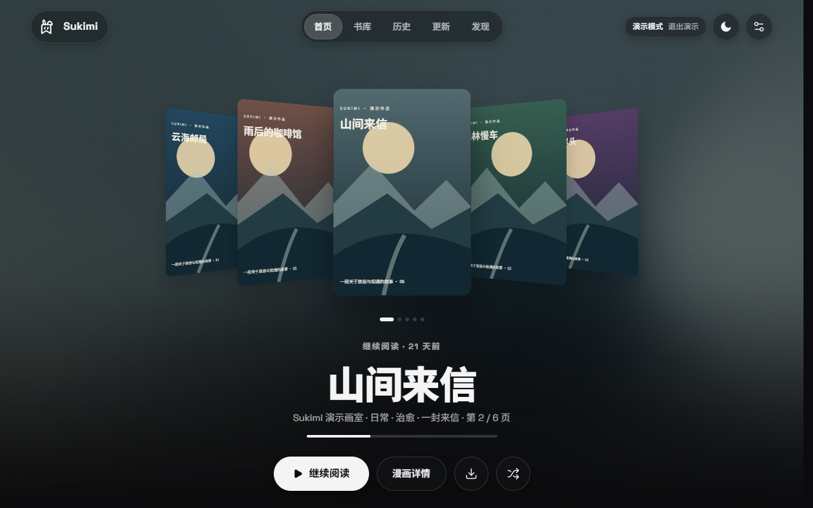
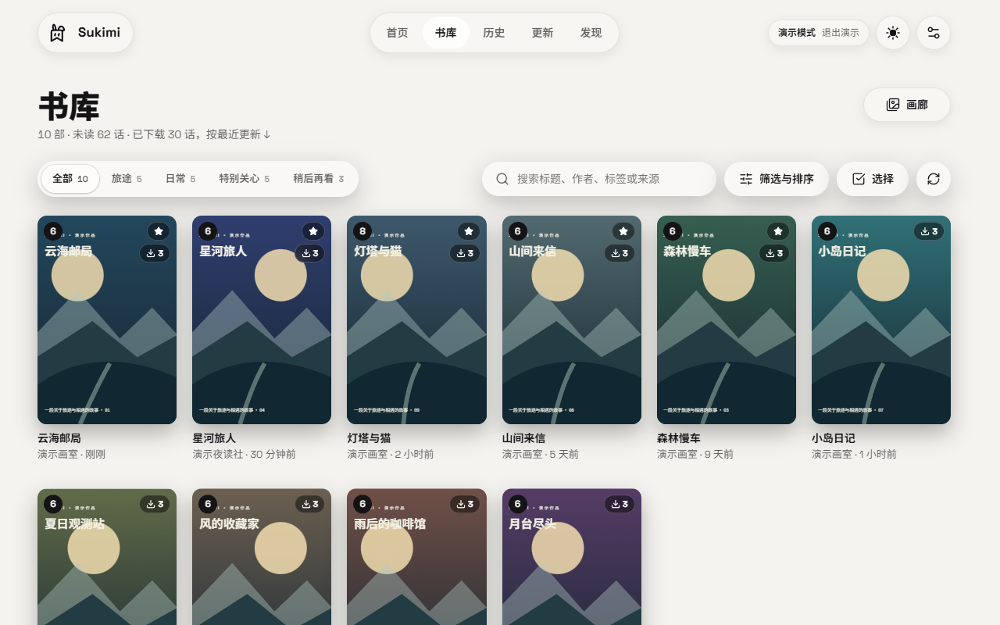
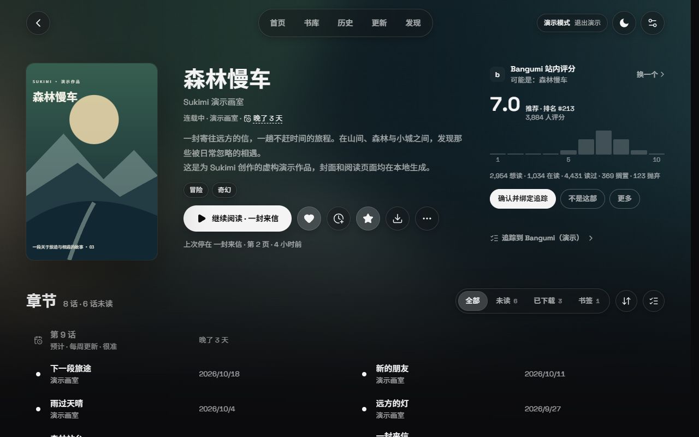

# Sukimi

为 [Suwayomi Server](https://github.com/Suwayomi/Suwayomi-Server) 打造的漫画网页客户端。采用液态玻璃设计，适配桌面和移动设备。

[English](README.en.md) · 界面支持简体中文和英文。



| 书库（浅色） | 漫画详情 |
| --- | --- |
|  |  |

## 功能

- **书库**：分类、筛选、排序、批量操作、最近更新与继续阅读。
- **阅读器**：单页、双页、纵向连续与 Webtoon 模式；触屏手势、缩放、自动裁白边、宽页拆分和图像滤镜。
- **阅读记录**：历史、进度、书签和按设备类型保存的阅读偏好。
- **内容管理**：来源浏览、扩展管理、换源、下载队列及第三方追踪。
- **界面**：深浅色主题、液态玻璃与不透明模式。
- **多用户**：账号注册与找回、管理员用户管理、按账号区分偏好与缓存（需要支持多用户的 Suwayomi Server）。

## 使用要求

- Suwayomi Server v2.4.2366 或更新版本。
- 服务端登录方式为 `UI_LOGIN`。
- 多用户功能需要包含用户账号功能的服务端版本（预览版自 v2.4.2379 起）；从旧版升级前请备份服务端数据。

## 安装

从 [webui-latest Release](https://github.com/MERURUXD/sukimi/releases/tag/webui-latest) 下载构建包。

### Windows / macOS / 桌面 Linux

1. 停止 Suwayomi。在 Launcher 的 `Root Directory` 中找到数据目录，备份 `server.conf` 和 `webUI/`。
2. 清空数据目录下的 `webUI/`，将 `sukimi-webui.zip` **内部文件**直接解压进去，确认 `webUI/index.html` 存在。
3. 在 [Suwayomi Launcher](https://github.com/Suwayomi/Suwayomi-Launcher) 的 `WebUI` 中启用 WebUI，将 `WebUI Flavor` 设为 `Custom`；在 `Authentication` 中选择 `UI_LOGIN`，然后点击 `Launch`。

### Linux / VPS（原生 Java / systemd）

1. 停止 Suwayomi，备份数据目录中的 `server.conf`，修改以下配置：

   ```hocon
   server.webUIEnabled = true
   server.webUIFlavor = "Custom"
   server.authMode = "ui_login"
   server.webUISubpath = ""
   ```

2. 下载 `sukimi-webui.tar` 到服务器，在压缩包所在目录执行（替换实际数据目录）：

   ```sh
   DATA_DIR=/path/to/Tachidesk
   if [ -d "$DATA_DIR/webUI" ]; then
     mv "$DATA_DIR/webUI" "$DATA_DIR/webUI.bak.$(date +%Y%m%d-%H%M%S)"
   fi
   mkdir -p "$DATA_DIR/webUI"
   tar -xf sukimi-webui.tar -C "$DATA_DIR/webUI"
   test -f "$DATA_DIR/webUI/index.html"
   ```

3. 按原有方式启动 Suwayomi（systemd 安装使用对应的服务单元）。

### Docker Compose（Linux / NAS）

在现有 [Suwayomi Docker Compose](https://github.com/Suwayomi/Suwayomi-Server-docker) 中设置以下字段：

```yaml
services:
  suwayomi:
    environment:
      - WEB_UI_ENABLED=true
      - WEB_UI_FLAVOR=Custom
      - AUTH_MODE=ui_login
    volumes:
      - ./data:/home/suwayomi/.local/share/Tachidesk
```

1. 执行 `docker compose stop suwayomi`，备份宿主机数据目录中的 `server.conf` 和 `webUI/`。
2. 将 `sukimi-webui.tar` 解压到宿主机的 `./data/webUI/`，确认该目录下直接包含 `index.html`。
3. 执行 `docker compose up -d suwayomi`。

上例使用绑定挂载 `./data`；如现有配置使用其他目录或命名卷，请操作对应的数据卷，不要修改原有数据挂载位置。

**更新**：停止 Suwayomi，备份并替换 `webUI/`，然后重新启动。**回退**：停止服务端并恢复备份；需要切回官方前端时，将 `WebUI Flavor` 改为 `WebUI`（Docker 修改 `WEB_UI_FLAVOR`）。

## 演示

打开已部署的 Sukimi，点击登录页的「无需登录，体验演示」，或访问 `/demo/`。可以使用虚构书库体验浏览和阅读，演示进度在刷新后重置。

## 本地开发

需要 Node.js 24 和 pnpm 11.22.0。

```sh
pnpm install --frozen-lockfile
cp .env.example .env.local
# 在 .env.local 中设置 SUWAYOMI_URL
pnpm dev
```

```sh
pnpm typecheck
pnpm test
pnpm build
```

修改 GraphQL 文档后运行 `pnpm codegen`；需要更新服务端 schema 时运行 `pnpm schema`。

### Preview 构建

使用 `SUKIMI_CHANNEL=preview pnpm build` 构建开发预览版，或从 [webui-preview Release](https://github.com/MERURUXD/sukimi/releases/tag/webui-preview) 获取构建。独立托管可参考 [Caddy 配置](deploy/preview/Caddyfile.example) 和 [更新脚本](deploy/preview/update-preview.sh)。

Preview 若连接同一 Suwayomi Server，**所有服务端数据仍与日用版共享**；需要隔离测试时请使用独立服务端实例。

## 许可

Sukimi 自有代码采用 [Mozilla Public License 2.0](LICENSE)（MPL-2.0）许可证。第三方代码遵循各自的许可条款，详见 [THIRD_PARTY_NOTICES.md](THIRD_PARTY_NOTICES.md)。
